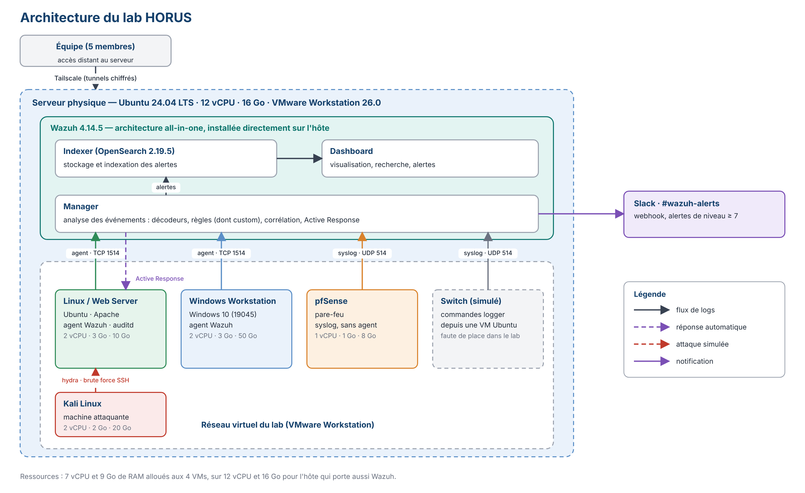
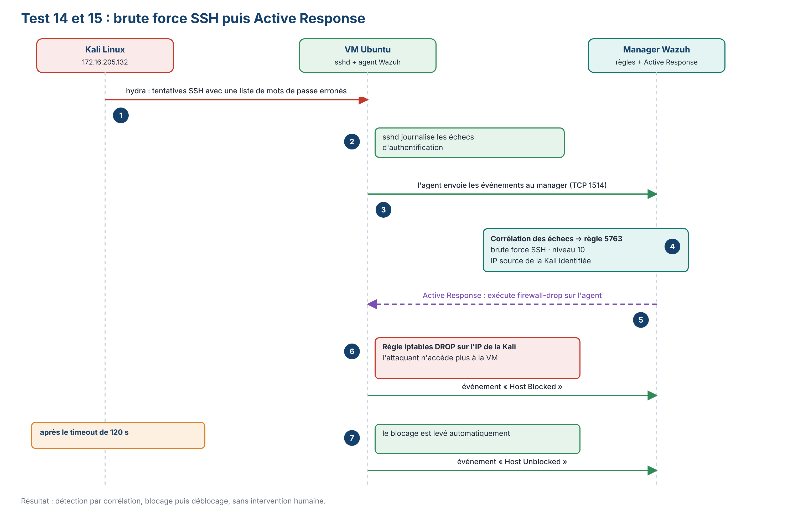
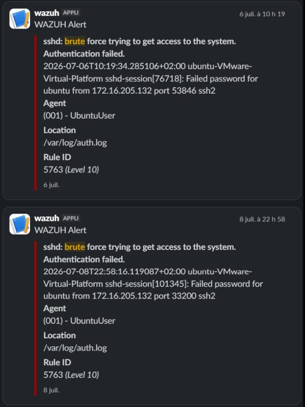

<p align="center">
  
</p>

# HORUS : SIEM/XDR open source avec Wazuh

```
analyst@horus:~$ ./horus --status
[+] collecte      : 5 sources (Linux, Web, Windows, pfSense, switch simulé)
[+] détection     : FIM, règles MITRE ATT&CK, règles custom
[+] réponse       : Active Response (firewall-drop)
[+] alerting      : webhook Slack (niveau >= 7)
[+] tests         : 15/15 OK
```

Projet de filière cybersécurité (école d'ingénieur, 4e année) : déployer et valider une plateforme SIEM/XDR basée sur `Wazuh` dans un lab virtualisé, puis la mettre à l'épreuve avec des attaques simulées depuis une Kali.

Le but n'est pas de développer un nouvel outil, mais de montrer qu'une supervision de sécurité complète (collecte, détection, réponse) se déploie **sans aucune licence**, là où Splunk, QRadar ou Sentinel coûtent cher.

## Le rapport

Tout le détail est dans le rapport : **[`docs/rapport.md`](docs/rapport.md)**.

| Section | Ce qu'on y trouve |
|---|---|
| 1. Contexte et périmètre | Problème de départ, objectifs, phases du projet |
| 2. Architecture retenue | Schéma du lab, choix techniques, machines et ressources |
| 3. Pourquoi Wazuh | Comparatif avec Splunk, QRadar et ELK |
| 4. Comment Wazuh traite un événement | Agent, manager, indexer, dashboard, décodeurs, règles, niveaux |
| 5 à 8. Réalisation | Collecte, détection (FIM, processus suspect, règles custom), Active Response, alerting |
| 9. Tests réalisés | Les 15 tests, un par un |
| 10 à 13. Projet | Organisation, planning, réglementation, limites, conclusion |

## Architecture du lab



Un serveur physique (`Ubuntu 24.04`) héberge `Wazuh` en all-in-one et les VMs du lab (`VMware Workstation`). L'accès distant de l'équipe passe par `Tailscale`.

## Démo : brute force SSH puis Active Response



1. `hydra` (Kali, `172.16.205.132`) attaque le SSH de la VM Ubuntu.
2. Wazuh corrèle les échecs et lève la règle `5763` (niveau 10).
3. `firewall-drop` bloque l'IP de la Kali avec une règle `iptables DROP`.
4. Après `120 s`, l'IP est débloquée automatiquement.

Ce que ça donne côté alerte dans Slack :



## Résultats des tests

7 exigences, 15 tests, tous validés.

| Exigence | Objectif | Tests | Résultat |
|---|---|---|---|
| R1 | Collecte des logs des 5 sources | 1 à 5 | OK |
| R2 | Détection de modification de fichiers (FIM) | 6 à 8 | OK |
| R3 | Détection de processus anormal | 9, 10 | OK |
| R4 | Règles de détection custom | 11 | OK |
| R5 | Notifications automatiques | 12 | OK |
| R6 | Conservation des logs | 13 | OK |
| R7 | Brute force SSH et réponse automatique | 14, 15 | OK |

## Stack et versions

| Composant | Version |
|---|---|
| Wazuh (manager, indexer, dashboard) | `4.14.5` |
| Indexer (OpenSearch) | `2.19.5` |
| VMware Workstation | `26.0.0.25388281` |
| Tailscale | `1.98.4` |
| Ubuntu (hôte et VM) | `24.04 LTS` |
| Windows (VM surveillée) | `10.0.19045` |
| pfSense, Kali Linux | pfSense (source syslog), Kali en rolling |

## Structure du repo

```
horus-wazuh-siem/
├── README.md
├── LICENSE
├── .gitignore
└── docs/
    ├── rapport.md          # rapport complet du projet
    └── images/             # schémas du rapport et captures du lab (dashboard, alertes, Slack, iptables)
```

## Équipe

Projet réalisé à 5, avec une répartition en chef de projet, MOA, MOE, intégration et qualité, tests et validation.

## Licence

[MIT](LICENSE) pour la documentation et les fichiers de ce repo. Wazuh reste sous licence GPLv2.
