

  

# HORUS

**Déploiement et validation d'une plateforme SIEM/XDR open source avec Wazuh**

Rapport de projet

| | |
|---|---|
| **Cadre** | Projet de filière cybersécurité, école d'ingénieur, 4e année |
| **Équipe** | 5 étudiants |
| **Période** | du 04/06/2026 au 09/07/2026 |
| **Rapport** | juillet 2026 |
| **Mots-clés** | Wazuh, SIEM, XDR, MITRE ATT&CK, Active Response, FIM |

---

## Table des matières

1. [Contexte et périmètre](#1-contexte-et-périmètre)
2. [Architecture retenue](#2-architecture-retenue)
3. [Pourquoi Wazuh](#3-pourquoi-wazuh)
4. [Comment Wazuh traite un événement](#4-comment-wazuh-traite-un-événement)
5. [Collecte des logs](#5-collecte-des-logs)
6. [Détection](#6-détection)
7. [Réponse automatique](#7-réponse-automatique)
8. [Alerting et rétention des logs](#8-alerting-et-rétention-des-logs)
9. [Tests réalisés](#9-tests-réalisés)
10. [Organisation du projet](#10-organisation-du-projet)
11. [Cadre réglementaire et risques](#11-cadre-réglementaire-et-risques)
12. [Limites de la solution](#12-limites-de-la-solution)
13. [Conclusion et perspectives](#13-conclusion-et-perspectives)
- [Annexe : glossaire](#annexe--glossaire)

---

## 1. Contexte et périmètre

### 1.1 Le constat de départ

Le projet HORUS part d'un constat simple : la majorité des cyberattaques qui touchent les entreprises, en particulier les PME, ne sont pas détectées assez tôt. D'après le rapport IBM Security 2024 cité dans notre cadrage, le délai moyen de détection d'une intrusion dépasse encore 200 jours. Pendant ce temps, l'attaquant peut exfiltrer des données, se déplacer dans le réseau ou déployer un ransomware.

Les solutions qui répondent à ce problème existent, ce sont les SIEM. Mais les grands noms du marché (Splunk, IBM QRadar, Microsoft Sentinel) ont un coût et une complexité d'intégration qui les rendent difficiles à adopter pour une petite structure.

### 1.2 Objectif

Nous avons voulu vérifier qu'une supervision de sécurité complète (collecte, détection, réponse) peut être déployée **sans aucune licence**, avec `Wazuh`, une plateforme open source qui réunit SIEM et XDR. Le projet n'est donc pas le développement d'un nouvel outil : c'est le déploiement, la configuration et la validation d'un outil existant dans un lab qui ressemble à une infrastructure d'entreprise, puis sa mise à l'épreuve avec des attaques simulées.

### 1.3 Périmètre

Tout a été réalisé dans un lab virtualisé. Ce déploiement est une étape préalable à un déploiement plus large en entreprise, qui n'est pas traité ici. Le projet est découpé en deux phases :

- **Phase 1, les fondations** : architecture all-in-one, collecte centralisée de 5 sources de logs, File Integrity Monitoring (FIM) et visualisation dans le dashboard.
- **Phase 2, les fonctions avancées** : règles de détection personnalisées, détection d'attaques simulées, Active Response (blocage automatique), alerting et gestion du cycle de vie des logs.

Les attaques sont lancées depuis une machine Kali Linux présente dans le lab.

### 1.4 Objectifs et mise en œuvre

| Objectif | Mise en œuvre | Section |
|---|---|---|
| Centraliser les logs de plusieurs sources | Agents Wazuh (Linux, serveur web, Windows) et syslog (`pfSense`, switch simulé) | 5 |
| Détecter les modifications de fichiers critiques | Module FIM, alertes de création, modification et suppression | 6.1 |
| Détecter l'exécution de processus suspects | Règles Wazuh sur Linux (`sudo`, `auditd`) et sur Windows | 6.2 |
| Aller au-delà des règles par défaut | Décodeur et règles custom pour une source non standard | 6.3 |
| S'aligner sur un référentiel reconnu | Mapping MITRE ATT&CK présent dans les alertes | 4, 6.2 |
| Répondre automatiquement à une attaque | Active Response `firewall-drop` contre un brute force SSH | 7 |
| Prévenir l'équipe en temps réel | Webhook Slack pour les alertes de niveau 7 et plus | 8 |
| Conserver les logs dans le temps | Rétention dans l'indexer, vérifiée après plusieurs jours | 8 |

---

## 2. Architecture retenue

### 2.1 Schéma d'ensemble

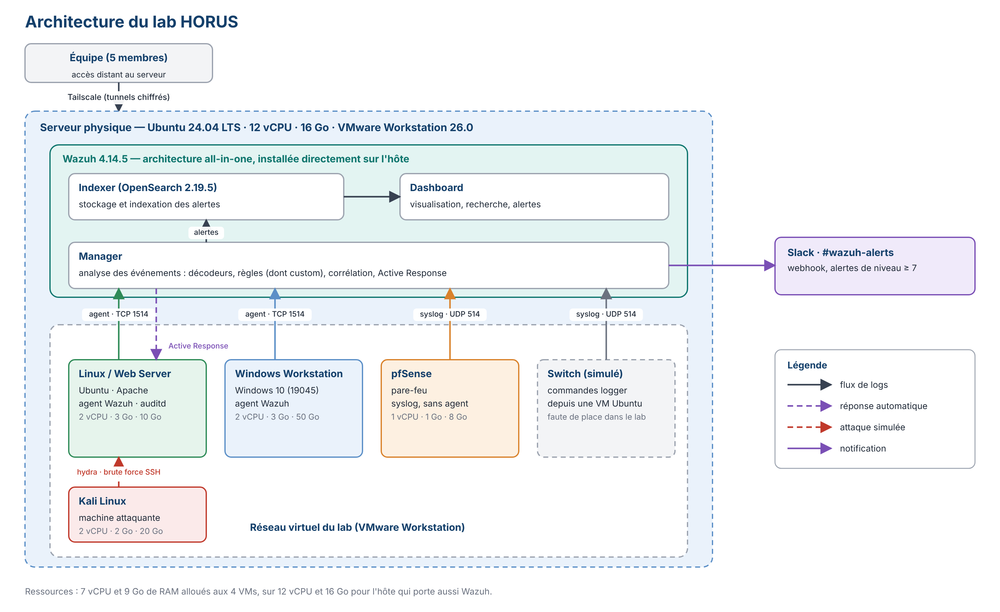

Un serveur physique unique, sous `Ubuntu 24.04 LTS`, héberge tout le lab. `Wazuh` est installé directement sur ce serveur en architecture **all-in-one**, c'est-à-dire que le manager, l'indexer et le dashboard tournent ensemble. Les autres machines sont des VMs créées avec `VMware Workstation`. Toute l'équipe accède au serveur à distance grâce à `Tailscale`.

Les flux principaux du lab sont les suivants.

- **Les agents Wazuh** (Linux/Web Server et Windows) envoient leurs événements au manager (`TCP 1514`, le port par défaut de Wazuh).
- **`pfSense`** n'a pas d'agent. Il envoie ses journaux en syslog sur `UDP 514`.
- **Le switch** est simulé. Des commandes `logger`, lancées depuis une VM Ubuntu, envoient des faux logs de switch en syslog sur `UDP 514`.
- **Le manager** analyse tout ce qui arrive, écrit les alertes dans l'indexer et envoie une notification Slack pour les alertes de niveau 7 et plus.
- **En cas de brute force**, le manager commande à l'agent concerné de bloquer l'IP de l'attaquant (section 7).
- **La Kali** joue le rôle de l'attaquant.

### 2.2 Choix techniques

| Composant | Rôle | Justification |
|---|---|---|
| `Wazuh 4.14.5` | SIEM/XDR | SIEM, XDR, FIM, mapping MITRE et réponse automatique réunis dans une seule solution gratuite (section 3) |
| `OpenSearch 2.19.5` (indexer) | Stockage et indexation des alertes | Composant d'indexation de Wazuh. Il garde l'historique, ce qui permet de rechercher dans le passé (section 8) |
| `VMware Workstation 26.0` | Hyperviseur | Permet de faire tourner tout le lab sur un seul serveur physique |
| `Tailscale 1.98.4` | Accès distant | VPN mesh qui crée des tunnels chiffrés entre les postes de l'équipe et le serveur |
| `Ubuntu 24.04 LTS` | Hôte et VM Linux | Système stable, utilisé pour l'hôte Wazuh et pour la machine Linux surveillée |
| `pfSense` | Pare-feu, source syslog | Source de logs réseau réaliste, surveillée sans agent |
| `Kali Linux` | Attaquant | Fournit les outils d'attaque, dont `hydra` |

**Pourquoi un all-in-one ?** Le but était de valider les fonctions de Wazuh, pas sa montée en charge. Mettre manager, indexer et dashboard sur le même serveur simplifie le déploiement et réduit les ressources nécessaires. En contrepartie, il n'y a aucune haute disponibilité (section 12).

**Pourquoi pas d'agent sur `pfSense` ?** Un pare-feu n'est pas fait pour accueillir un logiciel tiers. Le syslog est la voie normale pour récupérer ses journaux, et cela permet aussi de montrer qu'une source sans agent est supportée.

### 2.3 Machines et ressources

| Machine | OS | vCPU | RAM | Stockage | Rôle |
|---|---|---|---|---|---|
| Serveur physique | Ubuntu 24.04 LTS | 12 | 16 Go | ~98 Go, puis +100 Go le 28/06 | Héberge VMware et Wazuh (manager, indexer, dashboard) |
| Linux / Web Server | Ubuntu | 2 | 3 Go | 10 Go | Endpoint Linux surveillé (agent), serveur web Apache |
| Windows Workstation | Windows 10 (10.0.19045) | 2 | 3 Go | 50 Go | Poste Windows surveillé (agent) |
| pfSense | pfSense | 1 | 1 Go | 8 Go | Pare-feu, source syslog sans agent |
| Kali Linux | Kali (rolling) | 2 | 2 Go | 20 Go | Machine attaquante, sans interface graphique |

Les quatre VMs consomment 7 vCPU et 9 Go de RAM. Sur un hôte de 16 Go qui porte aussi Wazuh, la marge est faible. C'est ce qui explique l'absence de VM supplémentaire, et le choix de simuler le switch plutôt que de lui consacrer une machine.

---

## 3. Pourquoi Wazuh

### 3.1 L'offre existante

La supervision de sécurité repose sur deux familles de solutions : les SIEM, qui centralisent et corrèlent les journaux, et les XDR, qui détectent des menaces avancées et automatisent la réponse.

**Les solutions commerciales.** Splunk Enterprise Security est la référence du marché, avec des capacités très avancées. Sa tarification au Go ingéré par jour devient vite coûteuse. IBM QRadar vise les grandes entreprises aux exigences de conformité strictes. Microsoft Sentinel est cloud-native, très intégré à l'écosystème Microsoft, avec une facturation à la consommation. Pour une PME, ces trois solutions ont le même défaut : un coût élevé et une intégration complexe.

**Les alternatives open source.** L'ELK Stack est flexible pour centraliser et visualiser des logs, mais n'apporte pas de détection de sécurité avancée : il faut beaucoup de configuration pour atteindre un niveau SIEM. Security Onion est une distribution orientée analyse réseau (Suricata, Zeek, ELK) et demande des ressources importantes. Graylog a une interface agréable mais ses capacités de détection sont limitées sans modules complémentaires.

### 3.2 Comparatif

| Critère | Wazuh | Splunk | IBM QRadar | ELK Stack |
|---|---|---|---|---|
| Coût de licence | Gratuit | Très élevé | Très élevé | Gratuit |
| Fonctions SIEM | Oui | Oui | Oui | Partiel |
| Fonctions XDR | Oui | Via modules | Via modules | Non |
| FIM intégré | Oui | Non natif | Non natif | Non |
| Active Response | Oui | Non natif | Non natif | Non |
| MITRE ATT&CK natif | Oui | Oui | Oui | Non |
| Complexité de déploiement | Moyenne | Élevée | Très élevée | Élevée |
| Cible principale | PME/ETI | Grandes entreprises | Grandes entreprises | Toutes tailles |

### 3.3 Ce qui a fait pencher la balance

Wazuh est le seul de la liste à réunir SIEM, XDR, FIM et réponse automatique dans une plateforme open source (licence GPLv2). Trois points ont pesé dans le choix :

- **Le coût** : aucune licence, seul le matériel et le temps humain comptent.
- **L'intégration** : là où les autres solutions open source demandent d'assembler plusieurs outils (ELK pour les logs, Suricata pour le réseau, etc.), Wazuh propose le tout dans une seule plateforme, ce qui réduit l'administration.
- **Les standards** : le mapping MITRE ATT&CK est natif, donc les alertes parlent le même langage que le reste de la communauté.

Wazuh annonce plus de 20 millions d'endpoints déployés dans le monde et s'appuie sur une communauté et une documentation actives.

---

## 4. Comment Wazuh traite un événement

Pour comprendre la suite du rapport, il faut savoir ce qui se passe entre le moment où un événement est produit sur une machine et le moment où une alerte apparaît.

### 4.1 Les quatre composants

| Composant | Rôle |
|---|---|
| **Agent** | Logiciel installé sur une machine surveillée. Il collecte les journaux et l'état de la machine, et les transmet au manager. |
| **Manager** | Cerveau de la plateforme. Il analyse les événements avec des décodeurs et des règles, génère les alertes et déclenche les réponses. |
| **Indexer** (OpenSearch) | Stocke et indexe les alertes, ce qui permet de les rechercher. |
| **Dashboard** | Interface web pour consulter, filtrer et visualiser les alertes. |

Voici la vue d'ensemble du dashboard, avec le nombre d'alertes des dernières 24 heures classées par gravité, l'état des agents et les modules disponibles (FIM, MITRE ATT&CK, Threat Hunting, et des tableaux de bord de conformité comme PCI DSS, GDPR ou HIPAA).

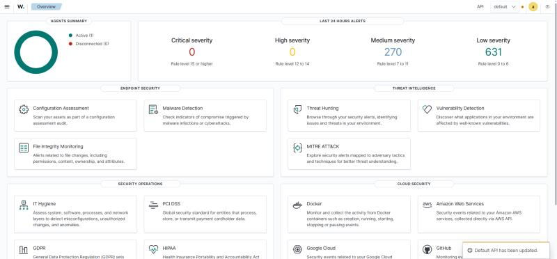

*Capture prise une fois le lab en fonctionnement : 1 agent actif, aucune alerte critique ni de gravité haute, 270 alertes de niveau 7 à 11 et 631 de niveau 0 à 6 sur 24 heures.*

### 4.2 La chaîne de traitement

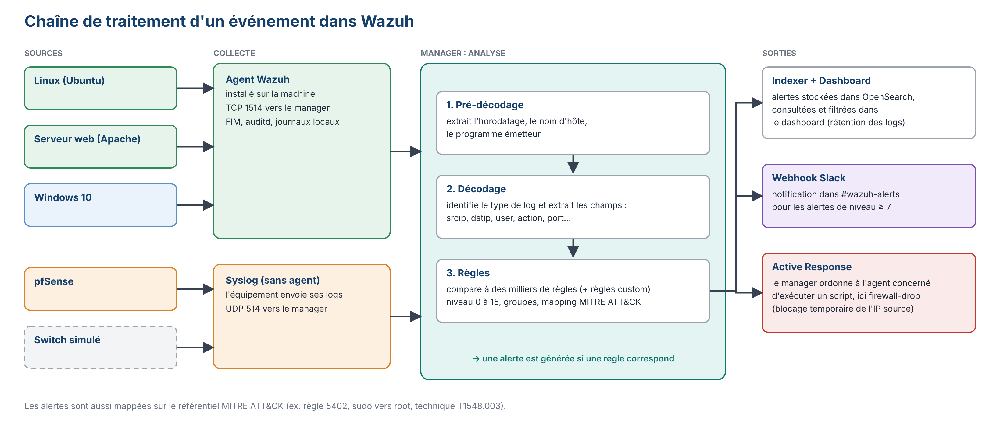

Dans le manager, un événement passe par trois étapes. On les voit une par une dans l'outil `wazuh-logtest`, qui permet de tester un log sans rien déployer et que nous avons utilisé pour valider nos décodeurs et nos règles.

1. **Pré-décodage.** Wazuh extrait les informations communes à tous les logs : horodatage, nom d'hôte, programme émetteur.
2. **Décodage.** Un décodeur reconnaît le format du log et en extrait des champs exploitables : adresse source, adresse destination, utilisateur, action, port. C'est cette étape qu'il faut écrire soi-même quand la source est non standard (cas de notre switch simulé).
3. **Application des règles.** Les champs sont comparés aux règles. Une règle qui correspond produit une alerte avec un identifiant, un **niveau** de 0 à 15, des groupes et, quand c'est renseigné, une correspondance MITRE ATT&CK.

Le niveau mesure la gravité. Plus il est haut, plus l'alerte est sérieuse. C'est pourquoi nous l'avons utilisé comme seuil pour les notifications Slack (niveau 7 et plus, section 8).

### 4.3 Les règles rencontrées dans le projet

| Règle | Niveau | Signification | Origine |
|---|---|---|---|
| `5402` | 3 | Successful sudo to ROOT executed (MITRE `T1548.003`) | Règle Wazuh par défaut |
| `5503` | 5 | PAM: User login failed | Règle Wazuh par défaut |
| `5760` | 5 | sshd: authentication failed | Règle Wazuh par défaut |
| `5763` | 10 | Brute force SSH (échecs d'authentification répétés) | Règle Wazuh par défaut |
| `553` | 7 | File deleted (FIM) | Règle Wazuh par défaut |
| `31101` | 5 | Web server 400 error code | Règle Wazuh par défaut |
| `31106` | 6 | A web attack returned code 200 (success) | Règle Wazuh par défaut |
| `31168` | 15 | Shellshock attack detected | Règle Wazuh par défaut |
| `100010` | 5 | Règle custom sur le switch simulé | Écrite par l'équipe |
| `100011` | 8 | Règle custom sur le switch simulé | Écrite par l'équipe |

Les identifiants à partir de `100000` sont réservés par Wazuh aux règles locales, ce qui évite les collisions avec les règles fournies.

---

## 5. Collecte des logs

**Exigence R1 : Wazuh collecte les logs de toutes les sources et les indexe correctement dans le dashboard.**

### 5.1 Sources avec agent

Trois machines remontent leurs événements grâce à un agent Wazuh :

- **Linux (Ubuntu).** L'agent détecte les événements système comme une connexion.
- **Serveur web (Apache).** Des requêtes HTTP sont générées, les logs du serveur apparaissent dans le dashboard.
- **Windows 10.** L'agent a été déployé le 01/07, plus tard que les autres. Il remonte les événements Windows comme l'ouverture de session. Cette VM est la plus volumineuse du lab en stockage (50 Go), et son déploiement a demandé de l'entraide dans l'équipe (section 10.4).

L'intérêt d'un agent est d'aller chercher l'information là où elle est : journaux locaux, état des fichiers, événements du système.

Dans le dashboard, la VM Ubuntu apparaît sous le nom d'agent `UbuntuUser` (ID `001`, IP `172.16.205.128`) et le serveur qui porte Wazuh sous le nom `homelab` (ID `000`, le manager lui-même).

**Preuve pour le serveur web.** La capture ci-dessous montre la page *Threat Hunting* filtrée sur le groupe de règles `web`, le 23/06/2026. Les requêtes HTTP générées pour le test ont été analysées par les règles web de Wazuh et ont produit trois alertes sur l'agent `UbuntuUser`.

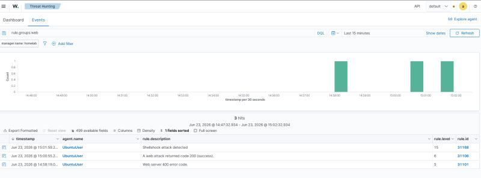

| Heure | Règle | Niveau | Description |
|---|---|---|---|
| 14:58:19 | `31101` | 5 | Web server 400 error code |
| 15:00:55 | `31106` | 6 | A web attack returned code 200 (success) |
| 15:01:59 | `31168` | 15 | Shellshock attack detected |

Les logs d'Apache ne sont donc pas seulement collectés : leur contenu est analysé, jusqu'à une détection de type Shellshock au niveau 15, le maximum de l'échelle.

### 5.2 Source sans agent : `pfSense`

`pfSense` est configuré pour envoyer ses journaux en syslog `UDP 514` vers le serveur Wazuh. Le manager écoute sur ce port et traite les messages comme ceux des agents. Les événements du pare-feu apparaissent dans le dashboard.

### 5.3 Source simulée : le switch

Faute de place dans le lab, le switch n'est pas une vraie machine. Nous le simulons avec des commandes `logger`, lancées depuis une VM Ubuntu, qui envoient des lignes de log au format d'un switch en syslog `UDP 514`. Du point de vue du manager, cela revient à recevoir les logs d'un équipement réseau.

Wazuh ne connaît pas ce format. Il a donc fallu écrire un **décodeur** et des **règles custom** (section 6.3). Cette source valide donc deux choses à la fois : la collecte syslog et la capacité à étendre Wazuh à un équipement non standard.

### 5.4 Résultat

Les cinq tests de collecte sont validés (tests 1 à 5, section 9).

---

## 6. Détection

### 6.1 File Integrity Monitoring

**Exigence R2 : Wazuh détecte les modifications non autorisées de fichiers critiques.**

Le FIM surveille des fichiers et des répertoires. Le principe est de garder une référence de leur état (empreinte, droits, propriétaire), puis de comparer à intervalles réguliers ou lors d'un changement. Toute différence produit une alerte. C'est un moyen de repérer une altération de fichier de configuration, l'ajout d'un fichier suspect ou une suppression.

Sur le serveur Linux, nous avons testé les trois cas sur un répertoire surveillé :

| Action | Alerte attendue |
|---|---|
| Modification d'un fichier surveillé | Alerte FIM indiquant le fichier modifié |
| Création d'un fichier | Alerte FIM signalant la création |
| Suppression d'un fichier | Alerte FIM signalant la suppression |

Les trois tests sont validés (tests 6 à 8).

Le FIM ne tourne pas que sur la VM : l'hôte Wazuh (`homelab`, agent `000`) est lui aussi surveillé. La capture suivante montre deux alertes de suppression de fichier (règle `553`, niveau 7) remontées dans Slack le 10/07, avec le détail du chemin, de l'agent et du module à l'origine de l'alerte (`syscheck`, le nom interne du FIM). Le mode est `scheduled` : le fichier a été repéré lors d'un scan planifié, pas en temps réel.

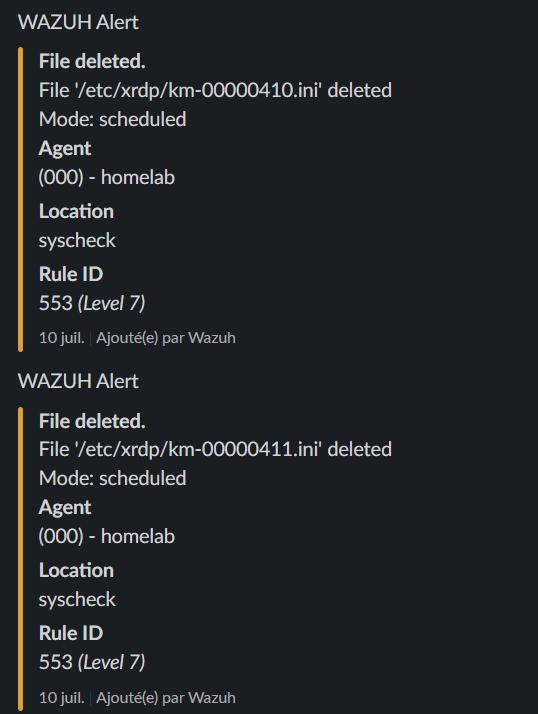

Comme ces alertes sont de niveau 7, elles franchissent le seuil de notification de Slack (section 8). Elles montrent aussi que le FIM peut être bavard (section 12).

### 6.2 Détection de processus suspect

**Exigence R3 : Wazuh détecte l'exécution d'un processus anormal.**

**Sur Linux.** Sur la VM Ubuntu, nous exécutons des commandes privilégiées via `sudo`, dont un accès à `/etc/shadow` (le fichier qui contient les empreintes des mots de passe). Wazuh génère l'alerte « Successful sudo to ROOT executed » (règle `5402`, niveau 3), mappée sur la technique MITRE ATT&CK `T1548.003` (*Abuse Elevation Control Mechanism: Sudo and Sudo Caching*, tactique Privilege Escalation).

Le niveau 3 est bas : la règle sert à **tracer** l'élévation de privilèges, pas à lever une alarme à elle seule. C'est le contexte (qui, quand, vers quel fichier) qui permet à un analyste de juger si l'action est légitime.

**Sur Windows.** Un processus anormal est exécuté sur le Windows Workstation et Wazuh génère une alerte Windows signalant l'exécution suspecte.

Les deux tests sont validés (tests 9 et 10).

### 6.3 Règles de détection personnalisées

**Exigence R4 : les règles créées par l'équipe se déclenchent correctement.**

Pour le switch simulé, nous avons écrit un décodeur et deux règles, `100010` (niveau 5) et `100011` (niveau 8). Le test consiste à envoyer un faux log syslog de switch depuis la VM Ubuntu avec `logger`. La règle `100011` se déclenche, l'alerte apparaît dans le dashboard et dans Slack.

Le décodeur et les règles ont été validés avec `wazuh-logtest` avant l'envoi du log depuis la VM. Cet outil montre chaque phase du traitement (pré-décodage, décodage, règles) et permet de voir où ça casse, au lieu de chercher une erreur de décodeur au milieu du flux de production.

Le test 11 est validé.

---

## 7. Réponse automatique

**Exigence R7 : Wazuh détecte un brute force SSH et bloque automatiquement l'IP attaquante (dimension XDR).**

C'est le scénario le plus complet du projet : il va de l'attaque à la réponse, sans intervention humaine.

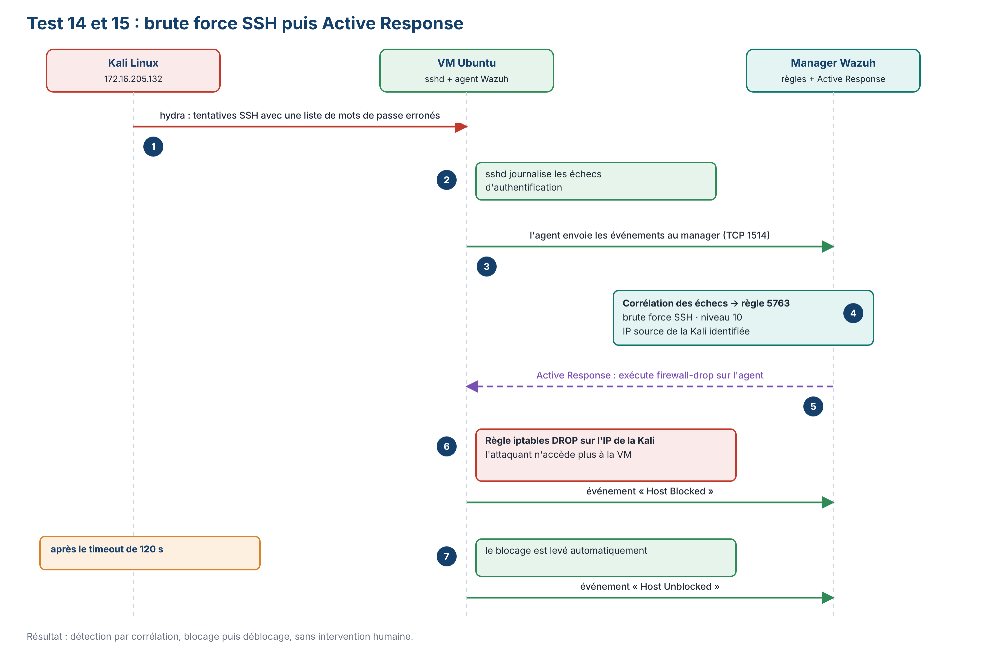

### 7.1 Déroulé

1. **L'attaque.** Depuis la Kali (`172.16.205.132`), nous lançons `hydra` contre le service SSH de la VM Ubuntu, avec une liste de mots de passe erronés. Chaque tentative échoue.
2. **La détection.** `sshd` journalise chaque échec, l'agent les envoie au manager, et Wazuh les met en corrélation : plusieurs échecs rapprochés depuis la même source déclenchent la règle `5763` (niveau 10). L'IP source de la Kali est identifiée dans l'alerte.
3. **La réponse.** Sur cette alerte, le manager demande à l'agent d'exécuter le script `firewall-drop`. Celui-ci ajoute une règle `iptables` qui rejette (`DROP`) le trafic venant de l'IP de la Kali. L'événement « Host Blocked » est enregistré.
4. **Le retour à la normale.** Au bout du timeout de `120 s`, la règle est retirée et l'événement « Host Unblocked » est enregistré.

### 7.2 Ce que montrent les captures

**La montée en gravité.** La liste des événements du 28/06 (agent `UbuntuUser`) montre comment des échecs individuels deviennent une alerte de corrélation. Les premiers échecs sont des alertes de niveau 5 : la règle `5503` (PAM: User login failed) à partir de 15:58:55, puis la règle `5760` (sshd: authentication failed) jusqu'à 15:59:01. À 15:59:01 apparaît la règle `5763`, de niveau 10.

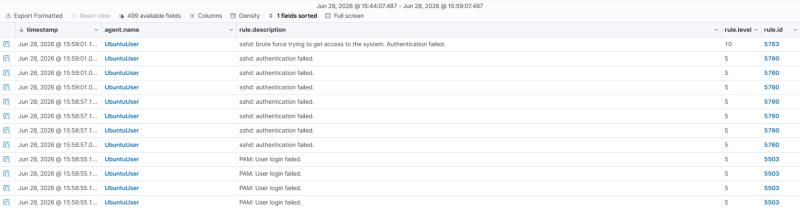

Un échec seul ne dit rien (tout le monde se trompe de mot de passe). C'est la répétition en quelques secondes qui fait passer l'alerte du niveau 5 au niveau 10.

**Le détail de l'alerte.** En ouvrant l'alerte `5763`, on retrouve les trois étapes de traitement vues en section 4 : le pré-décodage, le décodage, la règle.

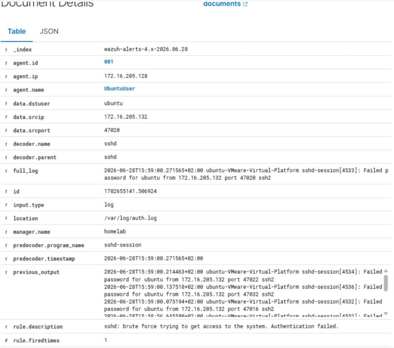

| Champ | Valeur | Ce que ça signifie |
|---|---|---|
| `location` | `/var/log/auth.log` | Fichier de la VM d'où vient le log |
| `predecoder.program_name` | `sshd-session` | Pré-décodage : le programme qui a écrit la ligne |
| `decoder.name` | `sshd` | Décodage : le décodeur qui a reconnu le format |
| `data.srcip` | `172.16.205.132` | IP de l'attaquant (la Kali) |
| `data.srcport` | `47020` | Port source de cette tentative |
| `data.dstuser` | `ubuntu` | Compte visé |
| `agent.ip` | `172.16.205.128` | IP de la VM Ubuntu (agent `001`, `UbuntuUser`) |
| `manager.name` | `homelab` | Manager qui a analysé l'événement |
| `rule.description` | sshd: brute force trying to get access to the system. Authentication failed. | Règle `5763` |
| `previous_output` | plusieurs lignes `Failed password for ubuntu from 172.16.205.132` | Les échecs précédents, que la règle a mis en corrélation |
| `_index` | `wazuh-alerts-4.x-2026.06.28` | Index de l'indexer qui contient l'alerte (un par jour, section 8) |

Le champ `previous_output` est la trace de la corrélation. Les ports sources des tentatives changent (`47016`, `47020`, `47022`, `47032`) et les horodatages sont séparés de moins d'un dixième de seconde : `hydra` ouvre plusieurs connexions SSH en parallèle. Le champ `data.srcip` est celui que `firewall-drop` reprend pour savoir quelle adresse bloquer.

**Le blocage.** Sur la VM Ubuntu, on vérifie que l'adresse est bien bloquée en listant les règles `iptables` qui la mentionnent.

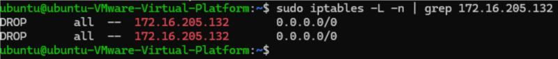

Il y a deux règles `DROP` pour `172.16.205.132` (source), vers n'importe quelle destination : le script `firewall-drop` en pose une pour le trafic entrant (chaîne `INPUT`) et une pour le trafic qui traverse la machine (chaîne `FORWARD`). Ces règles disparaissent au bout de `120 s`.

### 7.3 Pourquoi un blocage temporaire

Le timeout fait partie du dispositif. Un blocage définitif et automatique est risqué : si l'alerte est un faux positif (un utilisateur légitime qui se trompe de mot de passe, par exemple), il se retrouve exclu sans recours. Un blocage limité dans le temps casse l'attaque en cours tout en limitant les dégâts d'une erreur.

Les tests 14 et 15 sont validés.

---

## 8. Alerting et rétention des logs

### 8.1 Notifications

**Exigence R5 : Wazuh envoie des notifications automatiques lors d'un incident.**

Le manager envoie les alertes de niveau 7 et plus dans un canal Slack, `#wazuh-alerts`, via un webhook. Le message contient la description de l'alerte, l'agent concerné et le niveau de la règle. Le seuil à 7 évite de noyer l'équipe : les alertes informatives (comme la règle `5402`, niveau 3) restent dans le dashboard, les alertes sérieuses arrivent directement sous les yeux de l'équipe.

Le test a été fait en générant un événement de niveau 7 ou plus sur une source surveillée (test 12). La règle custom `100011` (niveau 8) l'a aussi franchi (test 11).

Les captures suivantes montrent ce que reçoit l'équipe : deux alertes de brute force SSH (règle `5763`, niveau 10) du 06/07 et du 08/07. Le message reprend la description de la règle, la ligne de log complète (avec l'IP source `172.16.205.132`), l'agent concerné (`001`, `UbuntuUser`), le fichier d'origine (`/var/log/auth.log`) et l'identifiant et le niveau de la règle. Il suffit de le lire pour savoir quoi vérifier, sans ouvrir le dashboard.

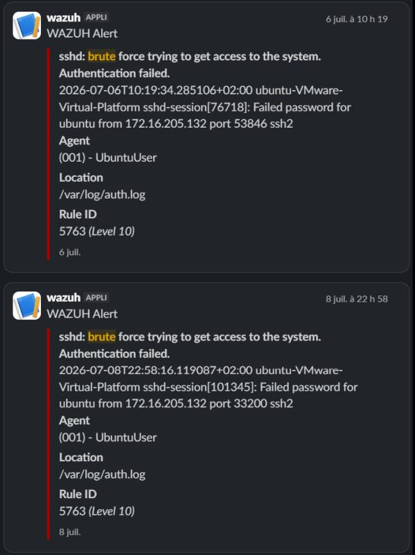

Ces alertes datent d'après la remise du rapport (06/07) : le lab a continué à tourner et à signaler des tentatives après la fin des tests principaux. Les alertes FIM de la section 6.1 arrivent avec le même format.

### 8.2 Rétention

**Exigence R6 : les logs sont conservés et gérés dans le temps.**

Les alertes sont stockées dans l'indexer, qui crée un index par jour : l'alerte de brute force du 28/06 se trouve par exemple dans `wazuh-alerts-4.x-2026.06.28`. Ce découpage par jour rend la rétention simple à gérer, puisqu'on peut conserver ou supprimer les données jour par jour. Après plusieurs jours de fonctionnement, nous avons vérifié que les logs des jours précédents restent consultables dans le dashboard, conformément à la politique de rétention définie (test 13). Le disque du serveur a d'ailleurs été étendu de 100 Go le 28/06.

La durée de conservation compte aussi du point de vue réglementaire : le RGPD impose de ne garder les données que le temps nécessaire (section 11).

---

## 9. Tests réalisés

Chaque exigence a été vérifiée par un ou plusieurs tests. Au total : **7 exigences, 15 tests, tous validés**.

| No. | Exigence | Test | Méthode | Résultat attendu | Obtenu |
|---|---|---|---|---|---|
| 1 | R1 | Collecte de l'agent Linux | Événement système (connexion) sur la VM Linux | Événements visibles avec les bons niveaux | OK |
| 2 | R1 | Collecte de l'agent Windows | Ouverture de session sur le Windows Workstation | Événements visibles avec les bons niveaux | OK |
| 3 | R1 | Collecte de l'agent Web Server | Requêtes HTTP vers Apache | Logs du serveur web dans le dashboard | OK |
| 4 | R1 | Syslog `pfSense` | `pfSense` envoie ses logs en `UDP 514` | Événements du pare-feu dans le dashboard | OK |
| 5 | R1 | Syslog du switch | Logs simulés envoyés sur `UDP 514` | Événements du switch simulé dans le dashboard | OK |
| 6 | R2 | FIM : modification | Modification d'un fichier surveillé | Alerte FIM | OK |
| 7 | R2 | FIM : création | Création d'un fichier dans un répertoire surveillé | Alerte FIM | OK |
| 8 | R2 | FIM : suppression | Suppression d'un fichier dans un répertoire surveillé | Alerte FIM | OK |
| 9 | R3 | Processus suspect, Linux | `sudo` vers `/etc/shadow` | Règle `5402` (niveau 3), MITRE `T1548.003` | OK |
| 10 | R3 | Processus suspect, Windows | Exécution d'un processus anormal | Alerte Windows | OK |
| 11 | R4 | Règle custom | Faux log de switch via `logger` | Règle `100011` dans le dashboard et dans Slack | OK |
| 12 | R5 | Notification | Événement de niveau 7 ou plus | Message dans `#wazuh-alerts` | OK |
| 13 | R6 | Rétention | Consultation des logs après plusieurs jours | Historique accessible | OK |
| 14 | R7 | Brute force SSH | `hydra` depuis la Kali (`172.16.205.132`) | Règle `5763` (niveau 10), IP source identifiée | OK |
| 15 | R7 | Active Response | `firewall-drop` sur détection | IP bloquée puis débloquée après `120 s`, événements « Host Blocked » et « Host Unblocked » | OK |

### Captures de preuve

| Test | Ce que la capture montre | Section |
|---|---|---|
| 3 | Alertes web (`31101`, `31106`, `31168`) sur l'agent `UbuntuUser` | 5.1 |
| 8 | Exemple d'alerte FIM de suppression de fichier (règle `553`) dans Slack, sur l'hôte et non sur la VM du test | 6.1 |
| 12 | Alertes de niveau 10 reçues dans Slack | 8.1 |
| 14 | Événements `5503`, `5760` puis `5763`, et détail de l'alerte | 7.2 |
| 15 | Règles `iptables DROP` sur l'IP de la Kali | 7.2 |

Les autres tests ont été validés dans le dashboard, mais sans capture conservée dans ce dépôt.

---

## 10. Organisation du projet

### 10.1 L'équipe

Le projet a été réalisé par une équipe de cinq étudiants, répartis comme suit.

| Rôle | Responsabilités |
|---|---|
| Chef de projet | Coordination générale, décisions opérationnelles, lien avec le référent lors des revues de jalon, supervision de la validation des tests, cohérence du rapport final |
| MOE | Infrastructure technique : serveur physique, VMware Workstation, Tailscale, création des VMs |
| Intégration, qualité, risques et budget | Déploiement de Wazuh (manager, indexer, dashboard), suivi de l'intégration, gestion des risques, du budget et de la qualité |
| Tests, validation et documentation | Configuration du FIM et des règles de détection, pilotage des tests, co-rédaction du rapport |
| MOA et documentation | Plans techniques du projet, co-rédaction du rapport |

### 10.2 Méthode

Nous avons choisi une approche **hybride**. Le cadrage, le périmètre, les livrables et le planning global ont été fixés en amont (logique prédictive). L'exécution est ensuite itérative, avec des activités qui se chevauchent volontairement.

Ce choix s'explique par l'incertitude du projet : l'équipe devait monter en compétence sur des outils peu maîtrisés comme Wazuh, et des difficultés d'intégration pouvaient apparaître en route. Nous avions par exemple prévu une alternative avec Docker en cas d'incompatibilité. En parallèle, les jalons de soutenance, fixés par le calendrier académique, ne se déplaçaient pas.

Le suivi reposait sur deux réunions par semaine (en présentiel ou sur Teams), un espace de travail partagé pour les tâches et des jalons hebdomadaires.

### 10.3 Planning

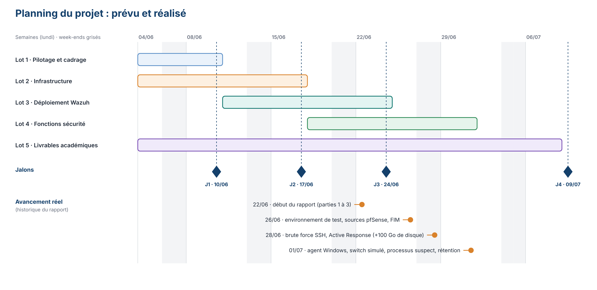

| Lot | Contenu | Début | Fin | Jalon |
|---|---|---|---|---|
| 1. Pilotage et cadrage | Cahier des charges, comparatif des solutions SIEM, justification du choix de Wazuh, répartition des rôles | 04/06 | 10/06 | |
| 2. Infrastructure | Serveur, VMware Workstation, Tailscale, déploiement des VMs | 04/06 | 17/06 | J1 (10/06) : infrastructure opérationnelle |
| 3. Déploiement Wazuh | Manager, indexer, dashboard, agents Ubuntu et Kali, syslog `pfSense`, agents Web Server et Windows | 11/06 | 24/06 | J2 (17/06) : Wazuh déployé, premiers agents connectés |
| 4. Fonctions de sécurité | FIM, règles de détection, dashboard, tests de bout en bout | 18/06 | 01/07 | J3 (24/06) : détection fonctionnelle, dashboard exploitable |
| 5. Livrables académiques | Rédaction progressive du rapport, finalisation, préparation de la soutenance | 04/06 | 08/07 | J4 (09/07) : validation finale, rapport, soutenance |

On remarque que le lot 4 se termine après le jalon J3 qui lui est associé. Les lots se chevauchent volontairement (c'est la partie itérative de la méthode), et c'est bien le lot 4 qui a le plus débordé sur la fin de la période.

### 10.4 Déroulé réel

D'après l'historique du rapport, voici comment le travail a avancé.

| Date | Avancement |
|---|---|
| 22/06 | Début du rapport (contexte, documentation, description du projet) |
| 26/06 | Environnement de test, suite de tests et conclusions. Validation de la source `pfSense` et du FIM |
| 28/06 | Détection du brute force SSH et Active Response. Suite de tests complète. Ajout de 100 Go de disque |
| 01/07 | Déploiement de l'agent Windows 10. Validation de la source switch simulé (décodeur et règles custom). Détection de processus suspect (Linux avec `auditd`, et Windows). Passage en OK des tests de collecte Windows, de processus, de règle custom et de rétention |

Les difficultés rencontrées ont surtout touché l'infrastructure : blocages réseau, configuration des agents, déploiement de la VM Windows, ressources limitées du serveur. Les blocages réseau ont été diagnostiqués avec `tcpdump`, en regardant ce qui arrivait réellement sur le serveur. Elles ont été résolues par l'entraide dans l'équipe et ont permis à chacun de monter en compétence sur des outils qu'il maîtrisait peu au départ.

---

## 11. Cadre réglementaire et risques

### 11.1 Réglementation

**En France.** Le RGPD impose de ne collecter que les données strictement nécessaires à la détection des menaces, de les conserver uniquement le temps nécessaire à l'analyse, et d'informer les utilisateurs de la surveillance de leurs activités. La loi de programmation militaire et les recommandations de l'ANSSI encadrent la supervision de sécurité pour les opérateurs d'importance vitale et les opérateurs de services essentiels. HORUS ne cible pas ces acteurs en première intention, mais s'aligner sur les recommandations de l'ANSSI reste un atout.

**À l'international.** `ISO/IEC 27001` impose des exigences de journalisation et de supervision que Wazuh adresse directement. `PCI DSS` (données de cartes bancaires) demande une supervision continue des accès aux données sensibles. `HIPAA` (santé aux États-Unis) exige une traçabilité complète des accès aux données de santé. Au niveau européen, NIS2 et DORA durcissent aussi les obligations de supervision.

### 11.2 Licence

Wazuh est distribué sous licence GPLv2. Elle autorise l'utilisation, la modification et la redistribution sans restriction dans un usage interne, donc aucun risque de contrefaçon dans notre cadre. Nos décodeurs, règles et documents sont la propriété du projet.

### 11.3 Matrice des risques

| Risque | Probabilité | Impact | Criticité | Mitigation |
|---|---|---|---|---|
| Changement de licence de Wazuh vers un modèle propriétaire | Faible | Élevé | Moyenne | Fork de la version GPLv2 ou migration vers Security Onion |
| Vulnérabilité découverte dans Wazuh | Moyenne | Élevé | Élevée | Suivi des CVE et mises à jour régulières |
| Dépendance à OpenSearch | Faible | Moyen | Faible | OpenSearch est open source (Apache 2.0) |
| Non-conformité RGPD sur les logs collectés | Faible | Très élevé | Élevée | Politique de rétention et minimisation des données collectées |
| Indisponibilité du serveur physique | Moyenne | Élevé | Élevée | Sauvegarde régulière des configurations Wazuh |

---

## 12. Limites de la solution

- **Un seul nœud, aucune redondance.** Manager, indexer et dashboard sont sur le même serveur, qui est lui-même unique. Si ce serveur tombe, la supervision s'arrête. La matrice des risques le classe d'ailleurs en criticité élevée.
- **Une marge de ressources faible.** Avec 16 Go de RAM partagés entre Wazuh et quatre VMs, le lab ne laisse pas de place pour une montée en charge. Un déploiement réel demanderait plusieurs nœuds.
- **Le switch est simulé.** Le décodeur et les règles custom ont été validés sur des logs que nous avons écrits nous-mêmes. Un vrai équipement peut produire des variantes de format que nos tests n'ont pas vues.
- **Une seule source custom.** L'extension de Wazuh a été démontrée sur un seul type de source. La couverture MITRE ATT&CK du projet reste limitée aux scénarios testés (élévation de privilèges, brute force).
- **Un scénario écarté.** Un cas d'usage de détection d'attaque de type MITM avait été envisagé. Il n'a pas été retenu pour des raisons techniques liées au lab, il ne fait donc pas partie de la suite de tests.
- **Le blocage automatique est sensible à l'IP source.** `firewall-drop` agit sur l'adresse que Wazuh voit dans les logs. En production, il faudrait une liste d'adresses à ne jamais bloquer (supervision, administration) pour éviter qu'une réponse automatique n'exclue un acteur légitime.
- **Le FIM peut être bruyant.** Sur l'hôte, des suppressions de fichiers dans `/etc/xrdp/` ont remonté en niveau 7 jusque dans Slack (capture de la section 6.1). Sans réglage, un FIM qui surveille des répertoires où des services écrivent régulièrement noie les alertes utiles. En production, il faudrait exclure ces chemins ou baisser le niveau de ces règles.
- **Le syslog en `UDP` n'est ni chiffré ni authentifié.** Les journaux de `pfSense` et du switch circulent en clair, et rien ne garantit qu'ils viennent bien de l'équipement annoncé. Dans un lab isolé, c'est acceptable. En production, il faudrait passer en TLS.
- **Le webhook Slack est un secret.** Son URL permet à n'importe qui de poster dans le canal. Elle doit être stockée comme un mot de passe et renouvelée en cas de fuite.
- **La politique de rétention reste à formaliser.** Nous avons vérifié que les logs se conservent, mais la durée de conservation doit être fixée selon le contexte d'usage (RGPD, exigences du secteur).

---

## 13. Conclusion et perspectives

Le projet a permis de déployer et de valider une plateforme SIEM/XDR complète basée sur Wazuh. Elle couvre les cinq sources attendues (Linux, serveur web, Windows, pare-feu et switch) et l'ensemble des fonctions de sécurité visées : collecte centralisée, détection d'intrusion, monitoring d'intégrité des fichiers, règles personnalisées, alerting en temps réel et réponse automatisée à un incident. Les 15 tests définis sont validés.

Au-delà de l'installation, le projet nous a fait pratiquer des réflexes d'analyste SOC : diagnostiquer méthodiquement (`tcpdump` pour comprendre un blocage réseau, `wazuh-logtest` pour valider chaque décodeur et chaque règle avant de les déployer), étendre l'outil au-delà de ses règles par défaut, et garder un regard critique sur les alertes. Le mapping MITRE ATT&CK déjà présent dans les alertes et l'Active Response forment une première étape concrète vers une réponse automatisée aux incidents.

Quatre pistes d'amélioration se dégagent :

- passer à une architecture **multi-node** pour un environnement de production ;
- intégrer des sources de **threat intelligence** externes ;
- **automatiser le déploiement** avec Ansible, pour rendre le lab reproductible ;
- **étendre la couverture MITRE ATT&CK** avec davantage de règles et de scénarios d'attaque.

---

## Annexe : glossaire

| Terme | Définition |
|---|---|
| **SIEM** | *Security Information and Event Management*. Plateforme qui centralise les journaux du système d'information pour la supervision, l'investigation et la conformité. |
| **XDR** | *Extended Detection and Response*. Architecture qui détecte les menaces avancées et automatise la réponse aux incidents. |
| **Agent** | Logiciel installé sur une machine surveillée, qui collecte les événements et les transmet au manager. |
| **Manager** | Composant de Wazuh qui analyse les événements, génère les alertes et déclenche les réponses. |
| **Indexer** | Composant de Wazuh (basé sur OpenSearch) qui stocke et indexe les alertes. |
| **Dashboard** | Interface graphique de visualisation des événements de sécurité. |
| **Décodeur** | Règle d'extraction qui reconnaît le format d'un log et en tire des champs (IP, utilisateur, action…). |
| **Règle** | Condition appliquée aux champs décodés. Quand elle correspond, elle produit une alerte avec un niveau de 0 à 15. |
| **FIM** | *File Integrity Monitoring*. Surveillance des modifications de fichiers par comparaison à un état de référence. |
| **Active Response** | Mécanisme par lequel le manager commande à un agent d'exécuter un script en réponse à une alerte. |
| **MITRE ATT&CK** | Référentiel public des tactiques et techniques d'attaque, utilisé comme langage commun pour classer les détections. |
| **Syslog** | Protocole standard d'envoi de journaux sur le réseau, ici en `UDP 514`. |
| **Brute force** | Attaque qui teste de nombreux mots de passe jusqu'à trouver le bon. |

### Références

- Documentation Wazuh : <https://documentation.wazuh.com>
- Référentiel MITRE ATT&CK : <https://attack.mitre.org>
